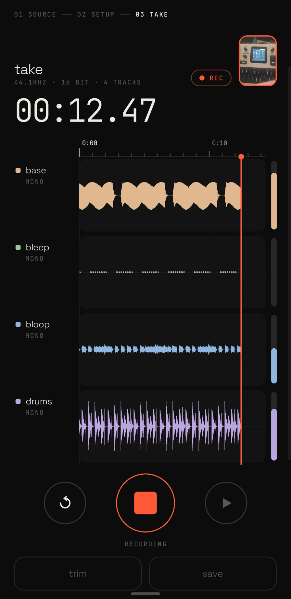

# take taker

Android multitrack recorder for USB audio interfaces. Plug in an
[FM-1 running the melodee firmware](#status), get its four outputs as four separate tracks, and
save them as FLAC stems, a mixdown, and optionally a video.

<p align="center"></p>

## Status

- **Alpha.** It works, it's young, expect rough edges.
- **Tested with the melodee firmware only** (FM-1, over USB), on one phone. Other class-compliant interfaces and phones should work but haven't been tried.
- **Get it:** APK on the [releases page](https://github.com/groundstation1/take-taker/releases/latest).

## Features

- **Multitrack recording**: every channel of a USB interface as its own track, including all 4
  FM-1 outputs, which Android itself would downmix to stereo ([raw USB mode](#known-limitations)).
  Name tracks, pair channels into stereo, add the phone mic.
- **Optional video or visualization**: film with the phone camera alongside the take, or export a
  rendered waveform video instead. Either way the soundtrack is the mixdown.
- **Normalized mixdown**: stereo MP3 mix normalized to -1 dBFS (or left as is), next to lossless
  FLAC stems.
- Auto-zooming live timeline, trim with in/out handles, preview / open / share after saving.

## How it works

- **01 source** — pick one or more inputs (USB interfaces, phone mics). Hot-plug aware.
- **02 setup** — per-channel live meters, name channels, link neighbours into stereo tracks,
  pick sample rate (defaults to the highest any selected source offers).
- **03 take** — record / restart (discard) / play / trim / save. The timeline auto-zooms out
  (10 s → 5 min window) with a 1 s / 10 s / minute tick hierarchy so zooming keeps its feel;
  pinch to zoom, drag to pan, double-tap to follow again, tap to place the play cursor.
- **trim** — drag in/out handles, play the selection.
- **save** — multitrack (one FLAC per track), multitrack + MP3 mix, or MP3 mix only, with the
  mix optionally normalized to -1 dBFS. Files land in `Music/TakeTaker/<name>_<yyyy-MM-dd_HHmm>/`.
  Optionally also an **MP4** in `Movies/TakeTaker/`: the camera footage recorded alongside the take
  (copied without re-encoding, lined up with the audio), or — without footage — a rendered waveform
  video (lanes, playhead, meters, timecode). Either way the soundtrack is the mixdown as AAC.
- **video** — pick back/front camera in setup to film alongside a take. Video-only capture
  (CameraX); the audio path doesn't change and the two are aligned by start time at export.
- **after saving** — preview the mixdown in place, open or share mixdown / video, or share a zip
  of everything (built only when asked for).
- Destructive actions (restart, recording over an unsaved take) are press-and-hold.

## Known limitations

- **Two capture paths for USB interfaces**, switchable per device on the source screen:
  - **raw** — the app claims the device's USB audio streaming interface and reads the isochronous
    stream itself (`src/main/cpp/usbiso.c`, usbfs, no root). Every channel, untouched. Needs a
    one-time USB permission; Android can't use the device while the app holds it. USB Audio
    Class 1 only for now (UAC2 devices fall back to system).
    Raw mode defaults to the device's lightest format at full channel count (16 bit on the
    FM-1, whose 24-bit format only pads 16-bit audio), which helps small synths near their
    CPU limit. A tucked-away "usb format" line at the bottom of setup lets you change it.
  - **system** — the normal Android audio path. Works with anything, but is subject to the vendor
    audio policy: on the test phone the HAL opens the FM-1 at 4 channels and then
    downmixes to stereo for apps. The app detects this and says so.
- The phone's built-in mics show up as one **Phone mic** source. Android gives an app a single
  built-in-mic input whichever capsule it asks for (selecting "bottom" and "back" separately
  recorded bit-identical audio), so what you choose instead is the recording preset:
  **stereo** (camcorder preset → real dual-mic input), **voice** (call preset: noise suppression,
  echo cancelling, mono) or **raw** (unprocessed, mono).
- Multiple sources record side by side with best-effort sync; independent device clocks will drift
  slowly over long takes.
- Raw takes are buffered uncompressed in the app cache until saved (~700 KB/s for 4 ch @ 44.1 kHz).
- MP3 is encoded with a pure-Java LAME port ([jump3r](https://github.com/Sciss/jump3r)), so mixdowns
  of long takes are slow-ish.
- Camera footage can only start on a keyframe, so a trimmed video export may begin up to about a
  second before the in point (the audio starts at the same moment, so they stay in sync).
- The FLAC encoder is a small hand-rolled one (fixed predictors + Rice coding). Output is verified
  bit-exact against ffmpeg in `EncoderTest`, but it compresses a bit worse than libFLAC.

## Build

Android SDK 36, NDK 28.2 (the one C file is compiled by a small Gradle task calling the
NDK's clang directly; ndk-build can't cope with spaces in the project path), JDK 17+.

```bash
./gradlew :app:assembleDebug
adb install -r -g app/build/outputs/apk/debug/app-debug.apk
```

`./gradlew :app:testDebugUnitTest` writes test FLACs and expected samples to `app/build/enc-test/`.

## Layout

```
app/src/main/java/app/taketaker/
  AppModel.kt        state machine (source → setup → live ⇄ trim, save)
  audio/Engine.kt    one capture thread per input (AudioRecord or raw USB), meters, takes to disk
  audio/UsbRaw.kt    UAC1 descriptor parsing + JNI binding for the iso reader
cpp/usbiso.c         isochronous IN streaming over usbfs
  audio/Take.kt      raw float32 per channel + peak summaries
  audio/Flac.kt      FLAC encoder
  audio/Exporter.kt  stems / mixdown / MediaStore publishing / zip
  video/CameraRig.kt video-only CameraX capture alongside a take
  video/VideoExport.kt  AAC mix + camera remux or rendered waveform video → MP4
  ui/Timeline.kt     ruler, waveforms, gestures, trim handles
  ui/Screens.kt      the screens
```

## Credits

- Fonts: [Space Grotesk](https://github.com/floriankarsten/space-grotesk) and
  [JetBrains Mono](https://github.com/JetBrains/JetBrainsMono), both SIL Open Font License 1.1.
- MP3: [jump3r](https://github.com/Sciss/jump3r) (LGPL), a Java port of LAME.
  `javax/sound/sampled/AudioFormat.java` is a minimal stub so it runs on Android.

## License

MIT for the app code. Bundled fonts remain under the OFL; jump3r under the LGPL.

## 🤖 Agentically engineered

**Built by a human and an AI agent, and proud of it.** The human set the direction, held the
hardware and made the calls; [Claude Code](https://claude.com/claude-code) wrote the code. Along
the way it read the phone's audio HAL logs to find out why 4 channels became 2, wrote a userspace USB
audio driver to get them back, and checked its own FLAC encoder bit-for-bit against ffmpeg.

**Know what you're running:** it has been exercised on one phone with
one instrument (FM-1 / melodee firmware), and reviewed by its makers, not by an outside pair of
eyes. Use it, fork it, file issues. No warranty — see LICENSE.
